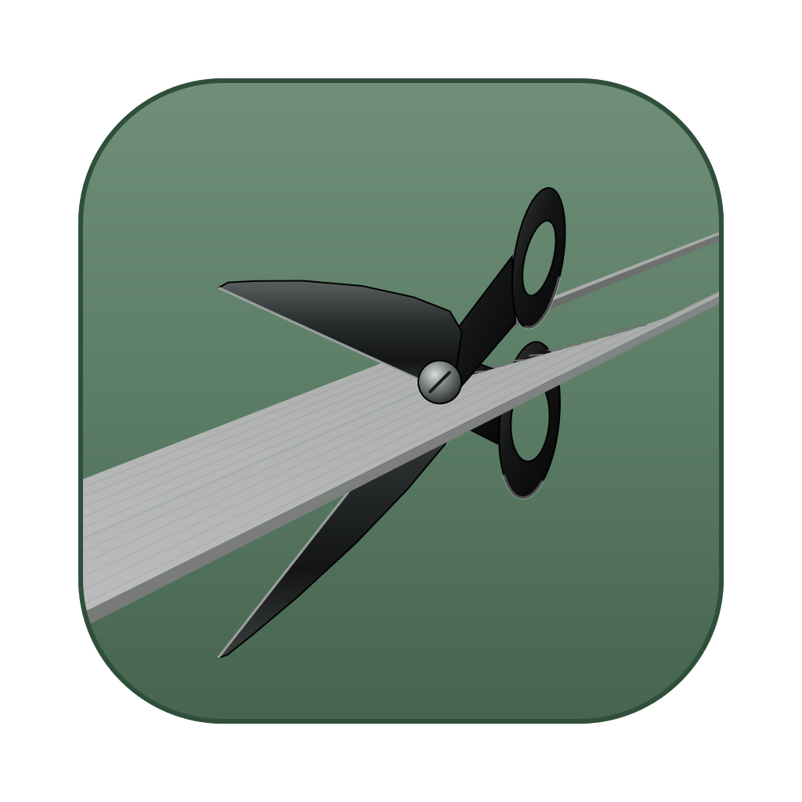
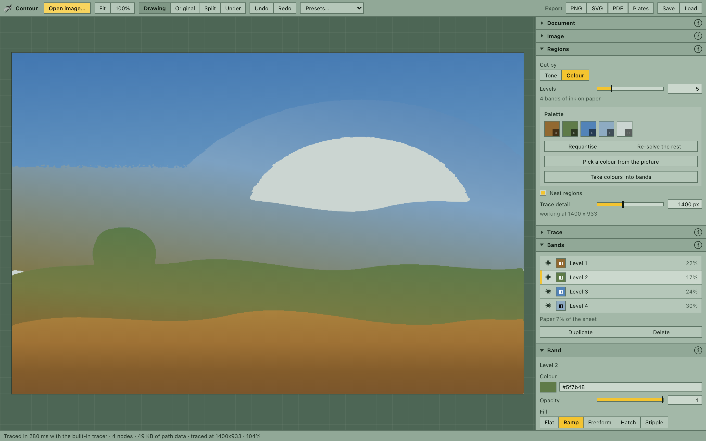

# Contour

Turn photographs into vector illustrations: cut the picture into tone or colour
regions, trace them into clean curves, and shade them with flat colour,
gradients, hatching or stipple. Exports real vector SVG and PDF, and films for
screen printing.



I've been using this to make flat vector illustrations and screen prints, and
it's freely available to anyone who'd like the same. It isn't a product. It's
the twin of [Stipple](https://github.com/aallevi/stipple), which does the same
job with points, and the two work the same way.

**[Try it in your browser →](https://aallevi.github.io/contour/)** No install
needed. Everything runs on your machine, and your images never leave it.

- **Regions by tone or by colour.** Posterise the picture into bands of tone,
  or into a palette of colours you can pin and pick from the picture itself.
- **Bands that nest.** Each band covers everything darker than it, so shapes
  overlap instead of abutting and no paper shows through along their edges.
- **Shading inside the shapes.** Flat colour, multi-stop gradients aimed from
  the photograph, freeform colour points, hatching that swells with tone, and
  stipple — all generated inside each region, so the file holds only marks
  you can see.
- **Made for printing.** Each band prints one ink; *Plates* writes one
  black-on-white film per band with registration marks, plus a colour proof.
- **Sizes that mean something.** Every length is a share of the picture, shown
  in mm or inches: resize or upscale the document and the drawing keeps its
  proportions.
- **The preview is the export.** What is on screen is the SVG the file will
  contain, put into the page instead of onto disk.
- **Anywhere.** In the browser, as a desktop app, or on a phone. Nothing is
  uploaded.

---

## Install

To run it locally, or to work on it:

You need [Node.js](https://nodejs.org) 20 or newer and a recent browser.

```bash
git clone https://github.com/aallevi/contour.git
cd contour
npm install
npm start
```

`npm start` builds the app and opens it at <http://localhost:4174>. Press
`Ctrl-C` in the terminal to stop it. That's the whole install; you don't need
Rust or a desktop shell.

| Command | What it does |
|---|---|
| `npm start` | Build, then serve and open in your browser |
| `npm run dev` | Live-reloading dev server at <http://localhost:1421> |
| `npm run build` | Type-check and write a static site to `dist/` |

`dist/` is plain static files with relative paths, so you can host it anywhere.
The live copy above is redeployed from `master` on every push by
`.github/workflows/pages.yml`.

### Optional: the desktop app

A native window (Tauri v2) adds two tracers and more file formats. In a browser,
tracing uses Contour's own built-in tracer; the desktop app also has
[vtracer](https://github.com/visioncortex/vtracer) compiled in and uses
[potrace](https://potrace.sourceforge.net/) if it is installed, and both fit
smoother curves. To build it you also need a [Rust toolchain](https://rustup.rs).

```bash
brew install potrace     # optional: the second tracer
brew install imagemagick # optional: PSD, HEIC, camera raw, PDF and more as input

npm run app              # run it in dev mode
npm run app:build        # bundle → src-tauri/target/release/bundle/
npm run install-app      # macOS: build and copy into /Applications (add -- --launch to open it)
```

---

## Usage

1. **Open an image.** Drop it on the stage, press *Open image…*, or `⌘O` /
   `Ctrl+O`. Drop another later to swap the picture under your drawing.
2. **Pick a preset** to see what's possible: *Flat colour*, *Symbol library*,
   *Two-ink poster*, *Contour lines*, *Engraving*, *Stippled shading* and
   others.
3. **Set the document** (top of the sidebar) to the size and resolution you'll
   print at, in pixels and millimetres. *2×* is the same print with twice the
   pixels.
4. **Work down the sidebar.** It follows the pipeline: *Image* (adjust, and
   blur away grain before it becomes contours) → *Regions* (tone or colour,
   how many, where they cut) → *Trace* → *Bands* → the selected *Band*'s fill
   and outline. A setting only affects the panels below it, and each panel's
   (i) explains it.
5. **Compare** beside *Fit*: *Original*, *Split* (drag the divider), or *Under*
   to see the photograph faintly through the paper. It is only a view and never
   appears in an export.
6. **Your colours.** Click the scissors mark, top left, to recolour the
   interface: *Fill*, *Lines* and *Text*, each from a grid of little squares or a
   fluid *Spectrum* swatch, then a saturation and brightness field with hue and *Vivid* (Display P3) sliders.
   *Background* sets the stage behind the sheet to *Grid*, *Squares* or
   *Marbled* (little squares combed like marbled paper); *Reset* brings back
   the green. With the paper set to *None* the sheet is see-through, with a thin
   line marking its edge, and the background shows behind the drawing.
7. **Export** to PNG, SVG or PDF, or *Plates* for screen printing. While a
   change retraces, a bar along the top of the stage says so, over the last
   drawing.

### From photo to screens

Every band is one ink. Cut by *Colour* to choose the inks — set or pin any
swatch, or *Pick a colour from the picture* — or by *Tone* for a ramp of one
ink. *+ Add band* adds one more region; *+ Add colour from picture* turns a
colour you click into a band of its own. The paper is the last row of the band
list: White, Cream, Kraft, Grey, Black or None (transparent), one click each.
Every level of the picture is a band, the lightest included, so the picture
is drawn whole on any paper; the paper shows only behind it, outside a cut-out
(a PNG with its background removed, which opens with the paper set to *None*).
The band list shows how much of the sheet each band prints. *Plates* then
writes one film per band, solid black on white, knocked out wherever a band
painted over it covers the paper, with identical registration marks on every
film. A band in the paper's own colour prints as the bare sheet and gets no
film; a band shaded with a gradient is not one ink, so it is left out and named.

### Shortcuts

| Key | Action |
|---|---|
| `⌘O` | Open image |
| `⌘S` | Save the document |
| `⌘E` | Export SVG |
| `⌘Z` / `⇧⌘Z` | Undo / redo |
| `0` | Fit to window |
| `Tab` | Cycle Drawing / Original / Split / Under |
| `Esc` | Cancel picking a colour |

Use `Ctrl` instead of `⌘` on Windows and Linux. On the stage, drag to pan,
scroll or pinch to zoom, and double-click or double-tap to fit. On a freeform
band, double-click adds a colour point.

On a phone, the picture sits on top and the controls scroll underneath; turned
sideways, they sit side by side. Swipe up and down to scroll, drag sideways to
move a slider, and use the plain strip down the right edge to scroll past
anything.

### Files

| | Formats |
|---|---|
| Images in | PNG, JPEG, WebP, GIF, BMP; TIFF and, with ImageMagick, PSD, HEIC, camera raw and PDF in the desktop app |
| Out | SVG and PDF (vector, at the document's print size), PNG at the document resolution, SVG plates |
| Documents | *Save* and *Load*: `.contour` in the desktop app, `.contour.json` in a browser |

---

## Learn more

- **[The guide](docs/GUIDE.md)** explains every control, the pipeline, both
  tracers, and the reasoning behind them.
- **[Contour and Stipple](docs/STIPPLE-PARITY.md)** lists what the two share and
  how each Stipple feature translates here.

```bash
npm test               # unit tests
npm run verify         # end-to-end browser checks (with `npm run dev` running)
python3 scripts/make-icon.py   # regenerate the icon, toolbar mark and favicon
```

Issues and pull requests are welcome.

## License

[MIT](LICENSE). Use it, change it, print with it.
